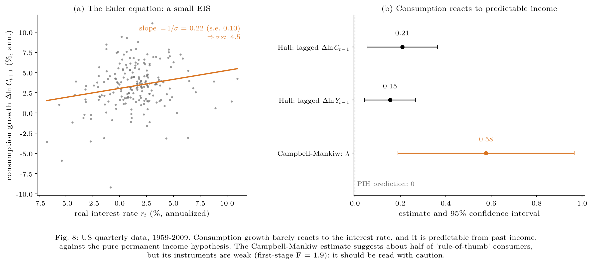
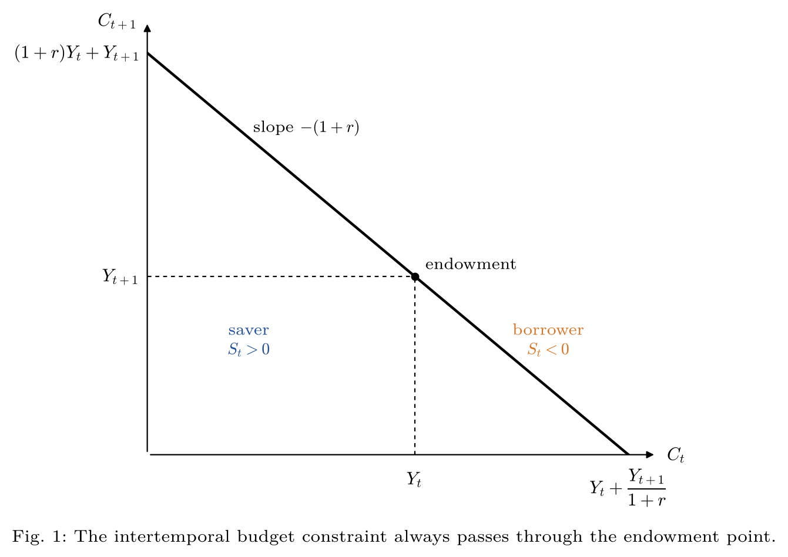
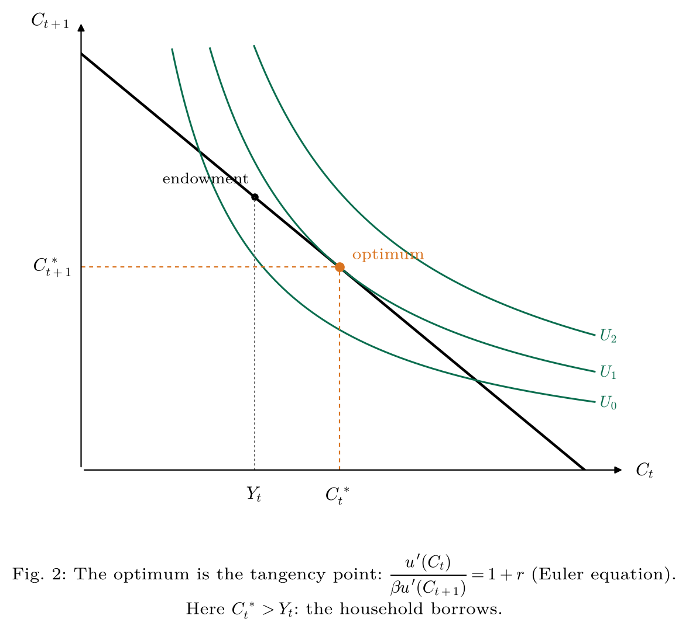
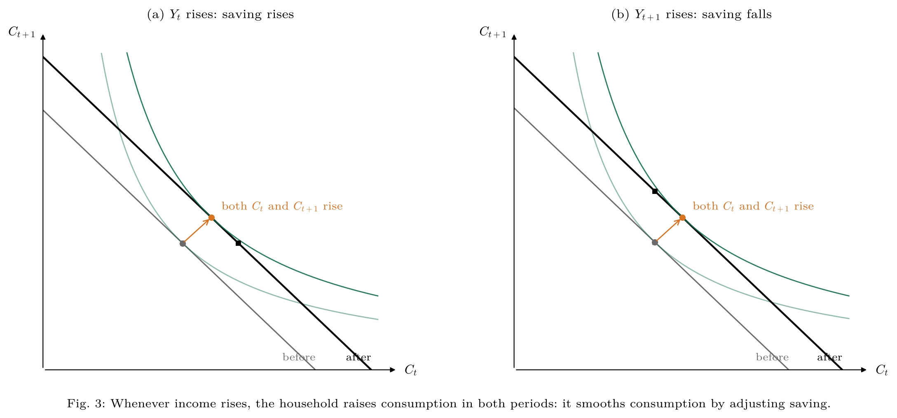
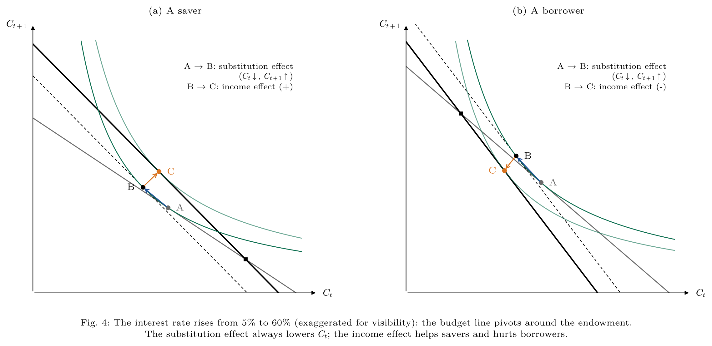
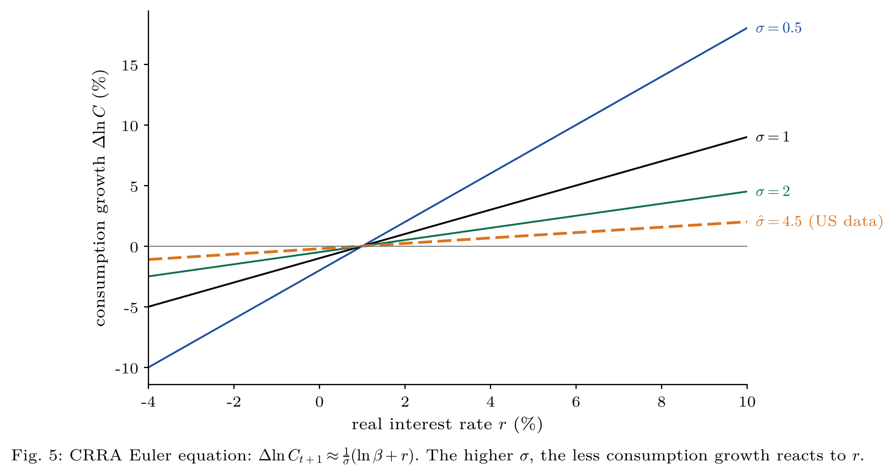
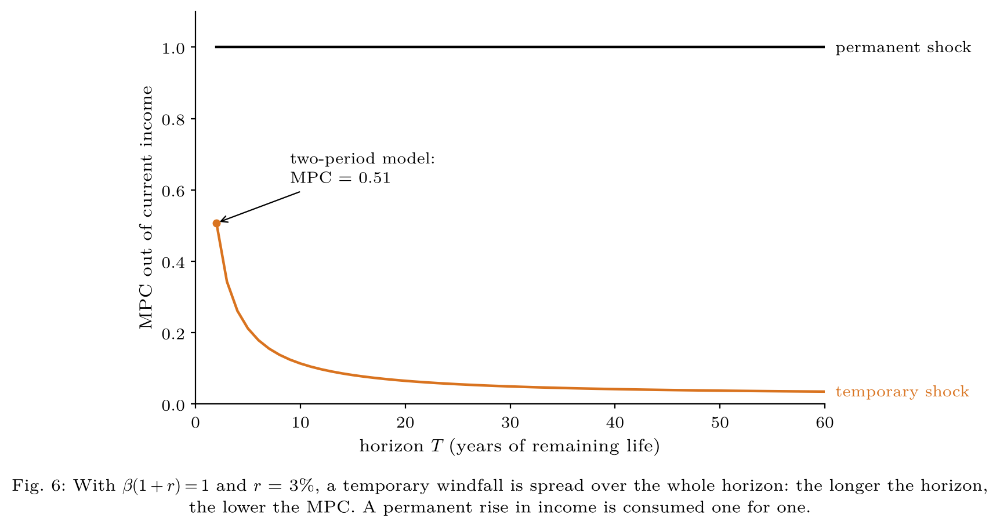
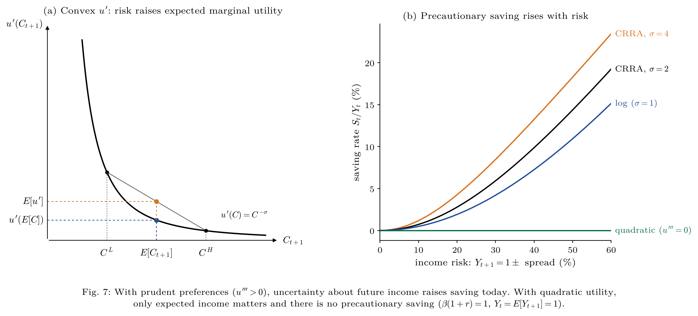
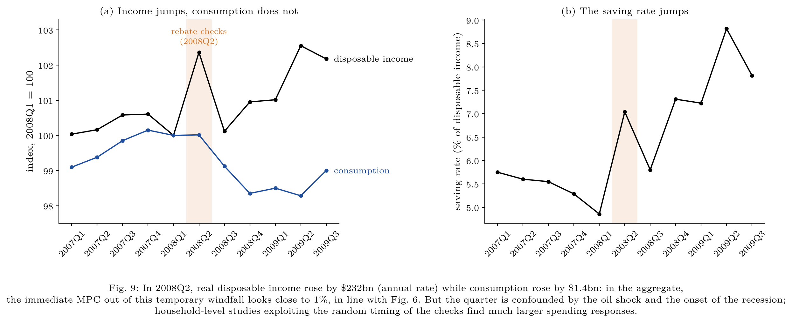

# The Two-Period Consumption-Saving Model

Theory and evidence on how households choose between consuming today and saving for tomorrow.
The first part solves and illustrates the two-period model; the second part tests its predictions on US data (1959–2009).

This project follows the [Solow model project](https://github.com/Imrane-Alami/Solow-model): Solow takes the saving rate as exogenous, while this model **derives saving from household choices**.

> **Key findings (US, 1959–2009).**
> - Consumption growth barely reacts to the interest rate: the estimated elasticity of intertemporal substitution is **0.22** (s.e. 0.10).
> - Consumption growth is **predictable from past income** (Hall test, p < 0.001), which rejects the pure permanent income hypothesis.
> - The Campbell-Mankiw estimate suggests that about **half** of consumption behaves like "rule-of-thumb" spending, but its instruments are weak.



---

## The model

A representative household lives two periods, receives exogenous incomes $Y_t$ and $Y_{t+1}$, and can save or borrow at the real rate $r$:

$$\max_{C_t,\,C_{t+1}} \; u(C_t) + \beta\, u(C_{t+1}) \qquad \text{s.t.} \qquad C_t + \frac{C_{t+1}}{1+r} = Y_t + \frac{Y_{t+1}}{1+r} \equiv W$$

The first-order condition is the **Euler equation**:

$$u'(C_t) = \beta (1+r)\, u'(C_{t+1})$$

With log utility, the consumption function is $C_t = \dfrac{W}{1+\beta}$. With CRRA utility $u(C) = \dfrac{C^{1-\sigma}}{1-\sigma}$, the Euler equation gives

$$\Delta \ln C_{t+1} \approx \frac{1}{\sigma}\left(\ln\beta + r\right)$$

where $1/\sigma$ is the elasticity of intertemporal substitution (EIS).

---

## Part 1 — Theory

### 1. The intertemporal budget constraint


### 2. The optimum


### 3. Consumption smoothing
Whether income rises today or tomorrow, consumption rises in both periods.


### 4. A higher interest rate
The substitution effect always lowers $C_t$; the income effect depends on whether the household is a saver or a borrower.


### 5. The Euler equation and the EIS


### 6. Temporary vs permanent shocks


### 7. Uncertainty and precautionary saving
When marginal utility is convex ($u''' > 0$), risk raises expected marginal utility tomorrow, so the household saves more today.


---

## Part 2 — Evidence from US data

| Test | Theory predicts | Estimate | Verdict |
|---|---|---|---|
| Euler equation: $\Delta\ln C_{t+1}$ on $r_t$ | slope $= 1/\sigma > 0$ | 0.22 (s.e. 0.10) | small EIS, $\sigma \approx 4.5$ |
| Hall (1978): $\Delta\ln C_t$ on lagged $\Delta\ln C$, $\Delta\ln Y$ | coefficients $= 0$ | 0.21 and 0.15, joint p < 0.001 | PIH rejected |
| Campbell-Mankiw (1989): $\Delta\ln C_t = \mu + \lambda\,\Delta\ln Y_t + \theta r_t$ (IV) | $\lambda = 0$ | 0.58 (s.e. 0.20) | weak instruments (first-stage F ≈ 2) |

Estimates use heteroskedasticity- and autocorrelation-robust (HAC) standard errors; Campbell-Mankiw uses two-stage least squares with lags 2–4 of consumption growth, income growth and the real rate as instruments.

### A natural experiment: the 2008 tax rebates


In the aggregate, income jumps in 2008Q2 while consumption stays flat. This looks like the textbook response to a temporary windfall, but the quarter is confounded by the oil price shock and the onset of the Great Recession. Household-level studies that exploit the random timing of the checks (Parker, Souleles, Johnson and McClelland, 2013) find much larger spending responses.

---

## Run it

```bash
pip install -r requirements.txt
python consumption.py
```

Figures are saved in `figures/` as PDF (vector) and PNG; `consumption_figures.pdf` gathers all of them.

## Structure

```
two-period-consumption-model/
├── consumption.py            # model, estimations and figures
├── style.py                  # shared textbook plotting style
├── data/us_macro_quarterly.csv
├── figures/                  # 9 figures (PDF + PNG)
├── consumption_figures.pdf
└── requirements.txt
```

## Data

US quarterly macroeconomic data, 1959Q1–2009Q3, distributed with `statsmodels` (`macrodata`): real personal consumption expenditures, real disposable personal income, 3-month T-bill rate and inflation. The ex post real rate is the T-bill rate minus realized inflation. An extract is saved in `data/us_macro_quarterly.csv`.

## Limitations

- The **ex post** real rate is used instead of the expected real rate.
- Consumption includes **durable goods**, which behave like investment rather than consumption.
- The weak first stage makes the Campbell-Mankiw estimate imprecise.
- The sample ends in 2009, before the 2020 stimulus payments.

## References

- Hall, R. (1978). "Stochastic Implications of the Life Cycle–Permanent Income Hypothesis." *Journal of Political Economy*.
- Campbell, J. and Mankiw, N. G. (1989). "Consumption, Income, and Interest Rates." *NBER Macroeconomics Annual*.
- Parker, J., Souleles, N., Johnson, D. and McClelland, R. (2013). "Consumer Spending and the Economic Stimulus Payments of 2008." *American Economic Review*.
- Garín, J., Lester, R. and Sims, E., *Intermediate Macroeconomics*, chapter 9.
